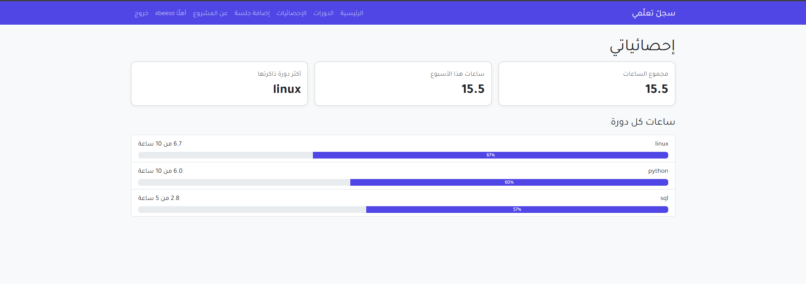

# Study Tracker — سجلّ تعلّمي

A Django web app for logging study sessions and tracking progress toward course goals.
Built with an Arabic right-to-left interface, multi-user accounts, and security reviewed by hand.



## Features

- Log study sessions: course, minutes, note, and date
- Add, edit, and delete sessions
- Statistics: total hours, this week's hours (week starts Sunday), and top course
- Target hours per course with progress bars
- Personal accounts: sign up, log in, log out
- Each user sees only their own sessions
- Arabic RTL interface built with Bootstrap 5

## Tech Stack

| Layer | Tools |
|---|---|
| Backend | Python, Django |
| Frontend | Django Templates, Bootstrap 5 (RTL), CSS |
| Database | SQLite |
| Server | Gunicorn, WhiteNoise, systemd |
| OS and tools | Ubuntu (WSL2), Bash, cron, Git |

## Security

Security was reviewed and tested manually as part of the project:

- **Access control:** every query is filtered by the logged-in user. IDOR was tested by changing record IDs in the URL, then fixed.
- **Ownership:** the owner of a session comes from the logged-in user, never from the form.
- **Uniform 404:** missing records and other users' records return the same response, so nothing is revealed.
- **Passwords:** hashed with PBKDF2 and a unique salt. Weak passwords are rejected.
- **CSRF:** every form is protected. Logout requires POST.
- **XSS:** template auto-escaping, tested with a script payload.
- **Secrets:** `SECRET_KEY` and `DEBUG` live in `.env`, outside the code. `DEBUG` is off by default.
- **File permissions:** `.env`, the database, and backups are `600`.
- **Least privilege:** Gunicorn runs as a normal user under systemd, with `NoNewPrivileges` and `PrivateTmp`.

## Run Locally

```bash
git clone https://github.com/xbeeso/study-tracker.git
cd study-tracker
python3 -m venv venv
source venv/bin/activate
pip install -r requirements.txt
cp .env.example .env
```

Generate a secret key and put it in `.env`:

```bash
python -c "from django.core.management.utils import get_random_secret_key; print(get_random_secret_key())"
```

Then:

```bash
python manage.py migrate
python manage.py createsuperuser
./run.sh
```

Open http://127.0.0.1:8000

## Deploy on Linux

```bash
python manage.py collectstatic
sudo cp deploy/study-tracker.service /etc/systemd/system/
sudo systemctl daemon-reload
sudo systemctl enable --now study-tracker
```

Edit `User` and the paths in the service file to match your server.

**Daily backups** with cron (keeps the newest 7):

```
0 21 * * * /path/to/study-tracker/backup.sh >> /path/to/backup.log 2>&1
```

## Project Structure

```
config/        Project settings and main URLs
tracker/       The app: models, views, forms, templates, static files
deploy/        systemd service file
run.sh         Start the development server
backup.sh      Safe database backup with rotation
```

## Next Steps

- HTTPS with Nginx and Let's Encrypt, then secure cookies and HSTS
- Automated tests
- Login rate limiting

## About

Built by **Bassam Basuliman** as a 20-day hands-on project applying the Python, Django, SQL, Linux, and cybersecurity courses from Tuwaiq Academy's Satr platform.